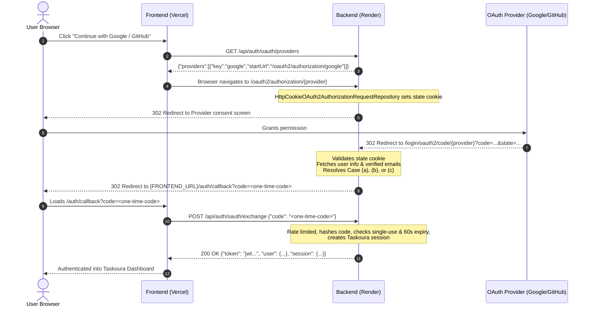

# Taskoura OAuth 2.0 Sign-In and Sign-Up Architecture & Configuration

This document outlines the Spring Security OAuth2 Login configuration, environment variables, local and production callback URLs, provider portal setup, and end-to-end testing workflows for Taskoura.

---

## 1. Environment Variables

Taskoura dynamically registers OAuth2 providers. If credentials for a provider are omitted, the application boots normally and that provider is excluded from the available provider list.

| Environment Variable | Description | Example (Local) | Example (Production on Render) |
|---|---|---|---|
| `GOOGLE_CLIENT_ID` | Google OAuth 2.0 Web Client ID | `*.apps.googleusercontent.com` | Configured in Render Dashboard |
| `GOOGLE_CLIENT_SECRET` | Google OAuth 2.0 Web Client Secret | `GOCSPX-...` | Configured in Render Dashboard |
| `GITHUB_CLIENT_ID` | GitHub OAuth App Client ID | `Ov23li...` | Configured in Render Dashboard |
| `GITHUB_CLIENT_SECRET` | GitHub OAuth App Client Secret | `47f8...` | Configured in Render Dashboard |
| `FRONTEND_URL` | Taskoura Frontend Base URL | `http://localhost:5173` | `https://taskoura.vercel.app` |

---

## 2. Exact Callback & Redirect URLs

### Backend Redirect URI Template
Taskoura configures the standard Spring Security redirect URI template:
`{baseUrl}/login/oauth2/code/{registrationId}`

`server.forward-headers-strategy=framework` is enabled in `application.properties` to ensure HTTPS scheme and Render reverse proxy headers are honored.

### Exact Callback URLs for Provider Dashboards

#### Local Development (`http://localhost:8081` or your configured `SERVER_PORT`)
- **Google Authorized Redirect URI**:
  ```
  http://localhost:8081/login/oauth2/code/google
  ```
- **GitHub Authorization Callback URL**:
  ```
  http://localhost:8081/login/oauth2/code/github
  ```

#### Production (Render Backend `https://taskoura.onrender.com`)
- **Google Authorized Redirect URI**:
  ```
  https://taskoura.onrender.com/login/oauth2/code/google
  ```
- **GitHub Authorization Callback URL**:
  ```
  https://taskoura.onrender.com/login/oauth2/code/github
  ```

---

## 3. Provider Console Configuration

### Google Cloud Console
1. Navigate to [Google Cloud Console Credentials](https://console.cloud.google.com/apis/credentials).
2. Create or configure an **OAuth 2.0 Client ID** (Application type: **Web application**).
3. Under **Authorized JavaScript origins**, add:
   - `http://localhost:5173` (Local frontend)
   - `https://taskoura.vercel.app` (Production frontend)
4. Under **Authorized redirect URIs**, add the exact backend callback URLs:
   - `http://localhost:8081/login/oauth2/code/google`
   - `https://taskoura.onrender.com/login/oauth2/code/google`
5. Save the generated Client ID and Client Secret into `GOOGLE_CLIENT_ID` and `GOOGLE_CLIENT_SECRET`.

### GitHub Developer Settings
1. Navigate to [GitHub Developer Settings -> OAuth Apps](https://github.com/settings/developers).
2. Register a new OAuth Application:
   - **Application name**: `Taskoura`
   - **Homepage URL**: `https://taskoura.vercel.app` (or `http://localhost:5173`)
   - **Authorization callback URL**:
     - Local: `http://localhost:8081/login/oauth2/code/github`
     - Production: `https://taskoura.onrender.com/login/oauth2/code/github`
3. Generate a Client Secret. Set `GITHUB_CLIENT_ID` and `GITHUB_CLIENT_SECRET`.

---

## 4. Authentication Architecture & Protocol Flow



### Flow Cases:
- **Case (a) - Existing Identity**: The user previously linked or signed up with this provider. Log in immediately.
- **Case (b) - New User**: No identity and no existing user with that email. Creates user (`verified=true`, `passwordLoginEnabled=false`, random unusable password hash), saves `oauth_identities` link, prefills `UserProfile` (`avatarUrl`, `githubUrl`), and logs in.
- **Case (c) - Account Exists with Password**: A Taskoura account exists with the same email, but not linked to this provider. The backend refuses to link or log in, redirecting to `{FRONTEND_URL}/auth/callback?error=ACCOUNT_EXISTS_USE_PASSWORD`.

### Error Codes for Redirects:
When an error occurs, the backend redirects (302) to `{FRONTEND_URL}/auth/callback?error=<CODE>`:
- `ACCESS_DENIED`: User cancelled or denied consent.
- `EMAIL_MISSING`: Provider did not provide an email address.
- `EMAIL_UNVERIFIED`: Provider email is unverified.
- `ACCOUNT_EXISTS_USE_PASSWORD`: Account exists with email; user must log in with password.
- `PROVIDER_DISABLED`: Attempted to start OAuth with an unconfigured provider.
- `PROVIDER_ERROR`: Upstream network or provider token exchange error.
- `STATE_INVALID`: CSRF state mismatch or missing state cookie.

---

## 5. Security & Privacy Guarantees

1. **Zero Token in URL**: Neither JWT access tokens nor provider OAuth tokens are ever passed in redirect URLs, query strings, or server logs.
2. **Single-Use 60s Exchange Codes**: The redirect carries an ephemeral code stored SHA-256 hashed in `oauth_login_codes`. Codes expire in 60 seconds and are invalidated on first use.
3. **Exchange Rate Limiting**: `POST /api/auth/oauth/exchange` is rate-limited per IP to prevent brute-force attempts.
4. **Password Login Guard**: Accounts created via OAuth have `password_login_enabled = false`. Traditional password login returns generic `401 Invalid credentials` to prevent account takeover without password setup. Password reset safely enables `password_login_enabled = true`.
5. **Private GitHub Emails**: For GitHub OAuth, Taskoura accesses `https://api.github.com/user/emails` to retrieve the verified primary address even when user profiles are set to private.

---

## 6. How to Test

### Automated Unit and Integration Tests
Execute the OAuth test suite:
```bash
mvn -f backend/pom.xml test -Dtest="OAuth2FlowTest,OAuthControllerTest,AuthServiceTest,UserServiceTest"
```

### Manual Testing with Real Credentials
1. Set the environment variables locally or in your test environment:
   ```bash
   export GOOGLE_CLIENT_ID="your-google-client-id"
   export GOOGLE_CLIENT_SECRET="your-google-client-secret"
   export GITHUB_CLIENT_ID="your-github-client-id"
   export GITHUB_CLIENT_SECRET="your-github-client-secret"
   export FRONTEND_URL="http://localhost:5173"
   ```
2. Start the backend:
   ```bash
   mvn -f backend/pom.xml spring-boot:run
   ```
3. Test provider list:
   ```bash
   curl -s http://localhost:8081/api/auth/oauth/providers
   ```
4. Navigate in a browser to:
   `http://localhost:8081/oauth2/authorization/google` or `http://localhost:8081/oauth2/authorization/github`
5. Verify redirection through provider consent to:
   `http://localhost:5173/auth/callback?code=<one-time-code>`
6. Test exchange via curl or frontend:
   ```bash
   curl -X POST http://localhost:8081/api/auth/oauth/exchange \
     -H "Content-Type: application/json" \
     -d '{"code":"<one-time-code>"}'
   ```
   Confirm 200 OK with `token`, `user`, and `session`.

---

## 7. Database Migration for Existing PostgreSQL Deployments (`password_login_enabled`)

When upgrading an existing database containing user records to support OAuth, run the safe migration script in Neon SQL Editor (`backend/docs/MIGRATION_PASSWORD_LOGIN_ENABLED.sql`):

```sql
-- Step 1: Add column as nullable
ALTER TABLE users ADD COLUMN IF NOT EXISTS password_login_enabled boolean;

-- Step 2: Backfill existing records based on password credential presence
UPDATE users
SET password_login_enabled = (password_hash IS NOT NULL AND password_hash <> '')
WHERE password_login_enabled IS NULL;

-- Step 3: Establish safe default for new rows
ALTER TABLE users ALTER COLUMN password_login_enabled SET DEFAULT true;

-- Step 4: Apply NOT NULL constraint safely
ALTER TABLE users ALTER COLUMN password_login_enabled SET NOT NULL;
```

